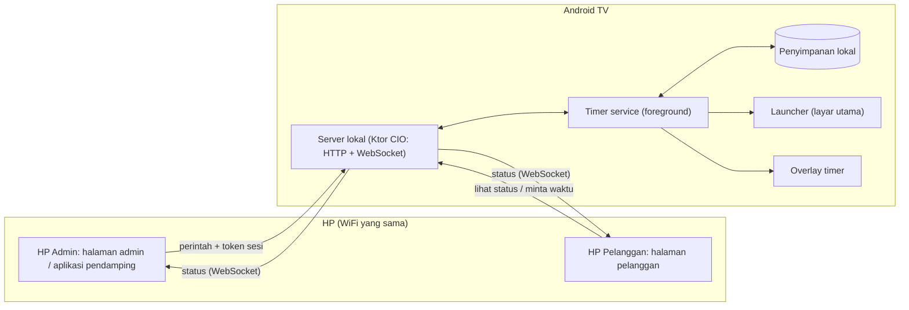
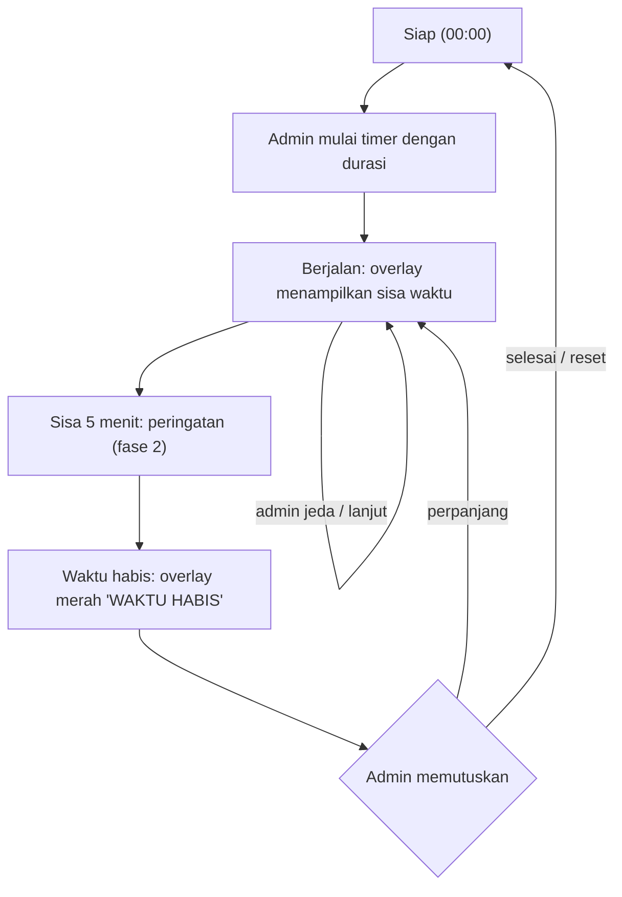
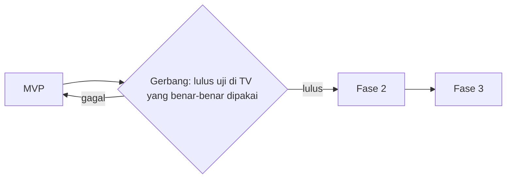

# PRD: Launcher Android TV Timer Karaoke

Oct 24, 2026 · @Akmal Fadli · Revisi 1.5 (lihat Riwayat revisi)

## Ringkasan dan latar belakang

Produk ini adalah aplikasi launcher Android TV yang menampilkan timer sewa ruang karaoke di atas aplikasi apa pun, dan dikendalikan operator lewat HP. Tujuannya mengakhiri pencatatan waktu manual dan mencegah pelanggan memperpanjang waktu tanpa membayar.

**Masalah saat ini**

- Waktu sewa dicatat manual atau dengan timer terpisah, sehingga rawan salah hitung dan lupa.
- Operator harus mendatangi tiap ruangan untuk menambah atau menghentikan waktu.
- Tidak ada penanda yang jelas bagi pelanggan saat waktu hampir atau sudah habis.

**Gambaran solusi**

- Aplikasi di TV bertindak sebagai launcher, menampilkan sisa waktu sebagai overlay di atas aplikasi karaoke (misalnya YouTube).
- Operator mengatur semua ruangan dari halaman web di HP yang terhubung ke WiFi yang sama.
- Pelanggan hanya bisa melihat sisa waktu dan meminta tambahan waktu.

## Tujuan dan metrik keberhasilan

Produk dianggap berhasil jika timer akurat, mudah dikendalikan operator, dan tidak membebani TV berspesifikasi rendah.

**Tujuan**

- Timer tetap tampil dan berjalan akurat di atas aplikasi karaoke.
- Operator mengontrol semua ruangan dari satu halaman di HP.
- Pelanggan mendapat peringatan sebelum waktu habis.

**Bukan tujuan (versi awal)**

- Pembayaran atau pencatatan keuangan otomatis.
- Aplikasi karaoke sendiri (katalog lagu, antrean lagu).
- Pengendalian di luar jaringan lokal (akses internet).

| Metrik | Target |
| --- | --- |
| Selisih waktu timer terhadap waktu nyata | Maksimal 2 detik per jam |
| Waktu dari tombol di HP sampai timer berubah di TV | Di bawah 1 detik di WiFi yang sama |
| Pemakaian RAM aplikasi di TV | Di bawah 150 MB |
| Timer tetap hidup saat aplikasi karaoke berjalan | 100% pada perangkat uji |

## Pengguna dan peran

Admin memegang kendali penuh, sedangkan pelanggan hanya melihat dan meminta.

| Peran | Akses | Cara masuk |
| --- | --- | --- |
| Admin (operator) | Mulai, jeda, hentikan, reset, tambah atau kurangi waktu, atur semua ruangan, lihat riwayat | Halaman web di HP, dilindungi PIN |
| Pelanggan | Lihat sisa waktu, kirim permintaan tambah waktu | Pindai QR code di ruangan, tanpa PIN |
| TV (perangkat) | Menjalankan timer, menampilkan overlay, mengirim status ke remote | Aplikasi launcher, punya nama atau ID ruangan |

## Ruang lingkup

Versi awal (MVP) mencakup satu timer per TV dengan kendali admin; fitur pelanggan dan multi-ruangan lanjutan menyusul.

| Fase | Isi |
| --- | --- |
| MVP | Launcher dasar, timer dengan overlay, server lokal, halaman admin ber-PIN, layar "Waktu Habis", tambah waktu, QR code admin dan bookmark untuk membuka halaman admin tanpa mengetik IP |
| Fase 2 | Peringatan 5 menit sebelum habis, bunyi alarm, halaman pelanggan (lihat sisa waktu dan minta tambah waktu), QR code pelanggan, dashboard banyak ruangan, aplikasi pendamping HP admin untuk menemukan TV otomatis dan menerima notifikasi, riwayat aksi |
| Fase 3 | Kirim tombol jeda ke aplikasi media saat habis, HDMI-CEC untuk mematikan TV, laporan pemakaian per ruangan |

## Kebutuhan fungsional

Setiap kebutuhan diberi prioritas: P0 wajib di MVP, P1 fase 2, P2 fase 3.

| ID | Kebutuhan | Prioritas |
| --- | --- | --- |
| F1 | Aplikasi terdaftar sebagai launcher (intent HOME) dan muncul di Android TV, navigasi lengkap dengan D-pad | P0 |
| F2 | Layar utama menampilkan sisa waktu dan pintasan ke aplikasi karaoke yang diizinkan | P0 |
| F3 | Timer berjalan di foreground service (tipe `specialUse` untuk Android 14 ke atas), dimulai saat launcher terbuka dan saat TV menyala (`BOOT_COMPLETED`); akurasi mengikuti Aturan akurasi | P0 |
| F4 | Overlay timer tampil di atas aplikasi lain (izin SYSTEM\_ALERT\_WINDOW), dengan posisi dan ukuran dapat diatur; jika TV tidak punya menu izin, izin diberikan lewat ADB (lihat Alur pertama kali dinyalakan) | P0 |
| F5 | Server HTTP dan WebSocket lokal di TV untuk menerima perintah dan mengirim status | P0 |
| F6 | Halaman admin: mulai, jeda, lanjut, hentikan, reset, tambah atau kurangi waktu | P0 |
| F7 | Saat waktu habis: overlay merah, teks "WAKTU HABIS", opsi perpanjang dari HP | P0 |
| F8 | Login admin dengan PIN | P0 |
| F9 | Peringatan 5 menit sebelum habis (visual dan bunyi) | P1 |
| F10 | Halaman pelanggan: lihat sisa waktu, tombol "Minta tambah waktu" yang mengirim permintaan ke admin. Permintaan tampil di halaman admin yang sedang terbuka dan sebagai notifikasi di aplikasi pendamping (F12); permintaan yang belum ditanggapi tetap tersimpan di TV sampai admin membukanya. Pelanggan dibatasi satu permintaan aktif per ruangan | P1 |
| F11 | QR code kedua di TV yang mengarah ke halaman pelanggan (terpisah dari QR code admin di F18 dan F19) | P1 |
| F12 | Aplikasi pendamping di HP admin yang menemukan semua TV otomatis lewat NSD, menampilkannya sebagai daftar ruangan tanpa mengetik IP, dan menampilkan notifikasi sistem untuk permintaan pelanggan dan event `timer_finished` | P1 |
| F13 | Dashboard admin mengontrol banyak TV sekaligus | P1 |
| F14 | Riwayat rental dan sesi (nama pelanggan, jam mulai, jam selesai, durasi awal, penambahan waktu, dan status sewa) dapat dilihat langsung dari HP operator | P0 |
| F15 | Kirim perintah jeda ke aplikasi media saat waktu habis (opsional per ruangan); di Sony Bravia lewat Bravia IP Control (perintah tombol remote IRCC "Pause") ke `127.0.0.1` | P2 |
| F16 | Matikan TV saat waktu habis; di Sony Bravia lewat Bravia IP Control (`setPowerStatus`) ke `127.0.0.1`, dengan HDMI-CEC sebagai cadangan | P2 |
| F17 | Cadangan kendali dari remote TV bawaan (tombol OK dan tombol warna) | P2 |
| F18 | Layar setup saat pertama kali dinyalakan: pilih launcher, aktifkan izin overlay (atau tampilkan instruksi ADB jika menu tidak tersedia), aktifkan pengecualian optimasi baterai, isi nama ruangan, buat PIN admin, lalu tampilkan QR code halaman admin | P0 |
| F19 | Layar utama setelah setup: status "Siap", sisa waktu 00:00, nama ruangan, pintasan aplikasi karaoke; QR code kecil di sudut hanya saat timer belum berjalan | P0 |
| F20 | Pengaturan (nama ruangan, PIN, izin) terkunci PIN setelah setup selesai, sehingga pemegang remote TV tidak bisa mengubahnya | P0 |

**Alur pertama kali dinyalakan**

1. Aplikasi ditetapkan sebagai layar utama. Di Android TV biasa, Android menanyakan layar utama dan admin memilih aplikasi ini sebagai pilihan tetap. Di Google TV (termasuk Sony Bravia XR X90), Android tidak menampilkan pilihan ini; launcher bawaan harus dinonaktifkan lewat ADB (lihat Perangkat target).
2. Aplikasi mengarahkan ke pengaturan izin "tampil di atas aplikasi lain"; tanpa izin ini timer tidak terlihat di atas aplikasi karaoke.
   - Banyak Android TV dan Google TV tidak menyediakan menu ini. Jika intent pengaturan gagal dibuka atau izin belum aktif, layar setup menampilkan perintah cadangan untuk teknisi: `adb shell appops set <package> SYSTEM_ALERT_WINDOW allow`.
   - Setup tidak bisa dilanjutkan sampai izin terdeteksi aktif; jika tetap tidak bisa, aplikasi memakai mode layar penuh sebagai cadangan (lihat Risiko dan mitigasi).
3. Aplikasi meminta pengecualian optimasi baterai agar service tidak dimatikan sistem.
4. Admin mengisi nama ruangan, misalnya "Ruang 1".
5. Admin membuat PIN admin.
6. TV menampilkan QR code dan alamat IP cadangan, sehingga HP admin bisa langsung tersambung ke halaman admin.

## Kebutuhan non-fungsional

| Aspek | Kebutuhan |
| --- | --- |
| Performa | Berjalan lancar di TV dengan RAM 1 hingga 2 GB; pemakaian RAM aplikasi di bawah 150 MB |
| Keandalan | Timer pulih otomatis setelah aplikasi di-restart atau TV dinyalakan ulang, dengan menyimpan status ke penyimpanan lokal |
| Akurasi | Berdasarkan jam monotonic (`elapsedRealtime`), tidak terpengaruh perubahan jam sistem; bukan hitungan mundur per detik (lihat Aturan akurasi) |
| Latensi | Perintah dari HP sampai berubah di TV di bawah 1 detik |
| Kompatibilitas | Perangkat target Sony Bravia XR X90 series (Google TV, Android 10 sampai 12, lihat Perangkat target); `minSdk` 29, `targetSdk` versi terbaru; tetap memakai tipe foreground service `specialUse` agar siap untuk Android 14 ke atas |
| Jaringan | Berjalan sepenuhnya di satu jaringan WiFi lokal yang dipakai bersama oleh TV, HP admin, dan HP pelanggan; tidak butuh internet |
| Kegunaan | Seluruh layar TV dapat dioperasikan dengan D-pad; teks besar dan terbaca dari jarak jauh |
| Keamanan | Lihat bagian Keamanan dan kontrol akses |

## Perangkat target

Keputusan: semua ruangan memakai **Sony Bravia XR X90 series 55 inci**. Seri ini memakai Google TV (bukan Android TV klasik), dengan Android 10 (X90J, X90K) atau Android 12 (X90L). Model persisnya perlu dicek di Settings > System > About > Model name.

| Aspek | Dampak pada aplikasi | Keputusan |
| --- | --- | --- |
| Launcher Google TV | Google TV tidak menyediakan pilihan layar utama; tombol Home selalu membuka launcher bawaan (`com.google.android.apps.tv.launcherx`) | Nonaktifkan launcher bawaan lewat ADB saat pemasangan sehingga tombol Home membuka aplikasi ini; perlu diverifikasi di TV nyata |
| Izin overlay | Menu "tampil di atas aplikasi lain" umumnya tidak tersedia di Google TV | Izin diberikan lewat ADB (`appops`) sebagai cara utama, bukan cadangan |
| Resolusi | Panel 4K, tetapi UI aplikasi Android TV dirender di 1920x1080 (dp) | Desain UI dan overlay untuk 1080p; teks overlay minimal setara 32sp agar terbaca dari jarak 3 meter di layar 55 inci |
| Remote | Remote Sony punya tombol pintas (YouTube, Netflix, Google Assistant), tombol Settings, dan tombol warna | Tombol pintas boleh dipakai (overlay tetap tampil); tombol warna dipakai untuk F17; akses ke menu Settings Android dibatasi lewat Pro mode Sony jika tersedia |
| Bravia IP Control | Sony menyediakan API jaringan (REST dan IRCC) untuk menyalakan, mematikan, dan mengirim tombol remote | Dipakai untuk F15 dan F16 di fase 3; aktifkan Settings > Network > Remote device settings > IP control dengan pre-shared key |
| Pro mode (mode hotel) | Menu tersembunyi Sony yang bisa mengunci menu Settings dan mengatur aplikasi saat TV menyala | Dievaluasi sebagai lapisan tambahan; ketersediaan di model consumer perlu dicek |
| Pembaruan sistem Sony | Pembaruan firmware bisa mengaktifkan kembali launcher bawaan atau mencabut izin | Matikan pembaruan otomatis; aplikasi memeriksa status izin dan launcher saat menyala dan memberi peringatan di halaman admin |

## Distribusi dan pemasangan

Keputusan: aplikasi **dipasang manual (sideload)**, tidak didistribusikan lewat Play Store. Konsekuensinya, tidak ada batasan review Play Store (izin launcher, overlay, dan foreground service `specialUse` bebas dipakai), tetapi pemasangan dan pembaruan menjadi tanggung jawab teknisi.

**Cara pemasangan**

| Cara | Langkah | Kapan dipakai |
| --- | --- | --- |
| ADB (wajib untuk pemasangan pertama) | Aktifkan Opsi pengembang dan debugging (USB atau jaringan) di TV, lalu jalankan skrip pemasangan dari laptop | Pemasangan pertama; di Sony Bravia XR X90 (Google TV) hanya ADB yang bisa memberi izin overlay dan menonaktifkan launcher bawaan |
| USB flashdisk | Salin APK ke flashdisk, buka dengan file manager di TV, izinkan "sumber tidak dikenal" untuk file manager tersebut | Hanya untuk pembaruan versi; izin dan pengaturan launcher dari pemasangan pertama tetap berlaku |

**Skrip pemasangan ADB** (dijalankan sekali per TV, perintah perlu diverifikasi pada model TV yang dipakai):

```bash
adb connect <ip-tv>:5555
adb install -r karaoke-launcher.apk
adb shell appops set <package> SYSTEM_ALERT_WINDOW allow
adb shell dumpsys deviceidle whitelist +<package>
adb shell cmd package set-home-activity <package>/.MainActivity
# Google TV (Sony Bravia XR X90): nonaktifkan launcher bawaan agar tombol Home membuka aplikasi ini
adb shell pm disable-user --user 0 com.google.android.apps.tv.launcherx
# Pemulihan jika perlu: adb shell pm enable com.google.android.apps.tv.launcherx
```

Setelah skrip dijalankan, layar setup (F18) otomatis melewati langkah izin yang sudah aktif dan langsung meminta nama ruangan dan PIN admin. Karena pelanggan memakai WiFi yang sama dengan TV, debugging ADB (USB dan jaringan) **wajib dimatikan** setelah pemasangan, dan layar setup memberi peringatan jika debugging masih aktif.

**Pembaruan aplikasi**

- Pembaruan dilakukan dengan memasang APK versi baru di atas versi lama (`adb install -r` atau lewat flashdisk); data timer, nama ruangan, dan PIN tetap tersimpan.
- Semua versi wajib ditandatangani dengan kunci (keystore) yang sama; keystore disimpan aman dan dicadangkan, karena tanpa kunci yang sama aplikasi harus dihapus dulu dan semua data hilang.
- Halaman admin menampilkan versi aplikasi di tiap TV agar operator tahu TV mana yang belum diperbarui.
- Pembaruan dari jarak jauh (TV mengunduh APK dari HP admin atau server lokal) tidak masuk versi awal.

## Arsitektur teknis



Timer service di TV menjadi pusat: ia menerima perintah dari server, menyimpan status, dan memberi data ke launcher serta overlay. HP hanya mengirim perintah dan menerima status lewat WebSocket, jadi timer tetap jalan walau WiFi putus.

**Teknologi yang dipilih**

- TV: Kotlin dan Jetpack Compose for TV (androidx.tv), karena paling ringan dan akses langsung ke overlay dan service.
- Server: Ktor dengan engine CIO untuk HTTP dan WebSocket.
- Halaman remote: React atau HTML biasa, dimasukkan ke folder assets aplikasi TV dan disajikan oleh Ktor.
- Penemuan perangkat: MVP lewat QR code dan bookmark, dengan IP TV dikunci lewat DHCP reservation di router; fase 2 lewat NSD di aplikasi pendamping HP admin.

## Perilaku timer dan alur pengguna

Timer berjalan dari mulai sampai habis, lalu admin memutuskan perpanjang atau selesai.



**Saat timer mencapai 0**

- Overlay berubah merah dan menampilkan teks "WAKTU HABIS" di atas aplikasi karaoke.
- Server mengirim event `timer_finished` ke halaman admin, yang menampilkan tombol perpanjang (misalnya tambah 5 atau 10 menit).
- Menjeda atau menutup aplikasi karaoke bersifat opsional dan masuk fase 3, karena aplikasi biasa tidak bisa menutup aplikasi lain secara paksa; yang realistis adalah mengirim perintah jeda media atau menampilkan layar penuh.

**Aturan akurasi**

- Saat berjalan, timer menghitung sisa waktu dari jam monotonic (`SystemClock.elapsedRealtime()`), bukan hitungan mundur per detik, sehingga tidak meleset bila service sempat tertunda dan tidak terpengaruh jika jam sistem diubah (sinkronisasi NTP atau diubah lewat pengaturan TV).
- Status yang disimpan ke penyimpanan lokal: status (`siap`, `berjalan`, `dijeda`, `habis`), sisa durasi, nilai `elapsedRealtime` dan jam dinding saat terakhir disimpan. Status disimpan setiap ada perintah dan secara berkala (misalnya tiap 30 detik).
- Saat dijeda, yang disimpan adalah sisa durasi, bukan waktu berakhir; saat dilanjutkan, waktu berakhir dihitung ulang dari sisa durasi.
- Setelah aplikasi di-restart (TV tetap menyala), sisa waktu dihitung dari selisih `elapsedRealtime`.
- Setelah TV dinyalakan ulang (`elapsedRealtime` kembali ke nol), sisa waktu dihitung dari selisih jam dinding sebagai perkiraan terbaik, dan admin diberi tanda "timer dipulihkan setelah TV mati" agar bisa mengoreksi.

## Keamanan dan kontrol akses

Kontrol timer terkait pembayaran, jadi hanya admin yang boleh mengubah waktu.

- Halaman admin dilindungi PIN; percobaan salah berulang dikunci sementara.
- Halaman pelanggan bersifat baca saja dan hanya bisa mengirim permintaan, tidak mengubah timer.
- Setiap perintah ke TV membawa token sesi yang didapat setelah login admin; perintah tanpa token ditolak.
- Server TV hanya menerima koneksi dari jaringan lokal (alamat IP privat).
- Karena HP pelanggan berada di WiFi yang sama dengan TV, keamanan tidak bergantung pada pemisahan jaringan: setiap endpoint admin di server wajib memeriksa token sesi, bukan hanya disembunyikan dari halaman pelanggan.
- Percobaan PIN dibatasi per perangkat dan per alamat IP (misalnya dikunci 5 menit setelah 5 kali salah) untuk mencegah tebakan PIN dari HP pelanggan.
- Token sesi admin punya masa berlaku (misalnya 12 jam) dan bisa dicabut dengan mengganti PIN.
- Komunikasi memakai HTTP biasa di WiFi lokal; WiFi wajib memakai kata sandi (WPA2 atau lebih baru). Enkripsi HTTPS di jaringan lokal tidak masuk versi awal.
- Setiap aksi admin dicatat: waktu, ruangan, jenis aksi, perubahan durasi.
- PIN disimpan dalam bentuk hash, bukan teks biasa.

## Risiko dan mitigasi

| Risiko | Dampak | Mitigasi |
| --- | --- | --- |
| Merek TV membatasi izin overlay atau mengganti launcher | Timer tidak tampil di atas aplikasi lain | Uji di perangkat yang akan dipakai sebelum rilis; berikan izin lewat ADB jika menu tidak ada; siapkan mode layar penuh sebagai cadangan |
| Jam sistem TV berubah (NTP, diubah manual) | Sisa waktu melompat maju atau mundur | Hitung sisa waktu dari `elapsedRealtime`; jam dinding hanya dipakai saat pemulihan setelah TV dinyalakan ulang |
| Pembatasan foreground service di Android 12 dan 14 ke atas | Service gagal dimulai dari latar | Tipe `specialUse` dideklarasikan; service dimulai dari launcher (foreground) atau `BOOT_COMPLETED` yang diizinkan |
| Admin tidak membuka halaman admin saat pelanggan meminta waktu | Permintaan terlewat | Permintaan disimpan di TV dan tampil saat halaman dibuka; notifikasi sistem lewat aplikasi pendamping di fase 2 |
| Sistem mematikan service di latar | Timer mati atau meleset | Foreground service, penyimpanan timestamp, pengecualian optimasi baterai |
| Aplikasi biasa tidak bisa menutup aplikasi lain | Lagu tetap jalan setelah waktu habis | Tampilkan layar penuh "Waktu Habis" dan kirim perintah jeda sebagai opsi |
| Pelanggan mengakses halaman admin | Waktu diubah tanpa bayar | PIN, token sesi, halaman pelanggan terpisah dan baca saja |
| WiFi tidak stabil | Perintah dari HP terlambat atau gagal | Timer tetap berjalan lokal di TV; remote menyambung ulang otomatis |
| TV berspesifikasi rendah | Aplikasi lambat | Kotlin native, server ringan (Ktor CIO), UI sederhana |
| IP TV berubah | QR code atau bookmark lama tidak berlaku | DHCP reservation di router; QR di TV selalu menampilkan alamat terbaru |
| Google Play Protect memberi peringatan atau memblokir APK sideload | Pemasangan atau pembaruan gagal | Pasang lewat ADB; jika muncul peringatan, pilih "tetap pasang"; uji pada model TV yang dipakai |
| Keystore penandatanganan hilang | Pembaruan tidak bisa dipasang di atas versi lama; data di TV hilang saat pasang ulang | Simpan keystore di lokasi aman dengan cadangan terpisah |
| Launcher Google TV tidak bisa diganti atau aktif kembali setelah pembaruan Sony | Tombol Home membuka Google TV; pelanggan keluar dari launcher | Nonaktifkan launcher bawaan lewat ADB; matikan pembaruan otomatis; overlay tetap tampil di atas Google TV karena dijalankan oleh service, bukan oleh launcher |
| Pelanggan membuka menu Settings Android lewat remote | Izin overlay dicabut atau aplikasi dihentikan paksa | Pro mode Sony jika tersedia; aplikasi memantau izin dan mengirim peringatan ke halaman admin bila izin hilang atau service berhenti |
| Debugging ADB dibiarkan aktif | Pelanggan di WiFi yang sama bisa mengubah atau menghapus aplikasi | Debugging wajib dimatikan setelah pemasangan; aplikasi menampilkan peringatan di layar setup dan halaman admin jika debugging masih aktif |
| Pelanggan di WiFi yang sama memanggil endpoint admin atau menebak PIN | Waktu diubah tanpa bayar | Token sesi diperiksa di setiap endpoint admin; batas percobaan PIN per IP; WiFi berkata sandi |

## Rencana rilis dan tonggak

Rilis dilakukan bertahap: fase 2 dan 3 baru dikerjakan setelah MVP lulus uji di TV yang benar-benar dipakai.



Kriteria gerbang: semua metrik di Tujuan dan metrik keberhasilan tercapai, izin overlay berhasil diaktifkan (lewat menu atau ADB), dan timer pulih dengan benar setelah aplikasi di-restart dan TV dinyalakan ulang.

Belum ada tanggal. Jadwal ditetapkan setelah jumlah ruangan dan model TV dikonfirmasi (lihat Pertanyaan terbuka).

## Pertanyaan terbuka

- [ ] Berapa jumlah ruangan dan TV yang akan dikelola? (Semua perangkat sudah diputuskan berada di satu WiFi lokal.)
- [x] Merek dan model TV apa yang dipakai? **Diputuskan: Sony Bravia XR X90 series 55 inci** (Google TV, lihat Perangkat target).
- [ ] Model X90 persisnya (X90J, X90K, atau X90L) dan versi Android yang terpasang?
- [ ] Apakah Pro mode (mode hotel) Sony tersedia di TV yang dipakai, dan apakah bisa mengunci menu Settings?
- [ ] Aplikasi karaoke apa yang dipakai pelanggan (YouTube, aplikasi lain)?
- [ ] Apakah waktu habis hanya memberi peringatan, atau juga harus menjeda pemutaran?
- [ ] Apakah perlu laporan pemakaian dan pendapatan per ruangan?
- [x] Apakah aplikasi akan didistribusikan lewat Play Store atau dipasang manual (sideload)? **Diputuskan: dipasang manual** (lihat Distribusi dan pemasangan).
- [ ] Siapa teknisi yang memasang dengan laptop dan ADB di tiap TV? (ADB wajib untuk pemasangan pertama di Google TV.)
- [x] Apakah TV dan HP pelanggan berada di WiFi yang sama, atau bisa dipisah? **Diputuskan: satu WiFi lokal bersama** untuk TV, HP admin, dan HP pelanggan (lihat Keamanan dan kontrol akses).

## Riwayat revisi

| Versi | Tanggal | Perubahan |
| --- | --- | --- |
| 1.0 | Oct 24, 2026 | Draf awal |
| 1.1 | Oct 24, 2026 | Cadangan izin overlay lewat ADB (F4, F18, alur setup); tipe foreground service dan pemicu start (F3); akurasi timer berbasis `elapsedRealtime` dan penyimpanan status jeda; kejelasan QR admin dan QR pelanggan; mekanisme notifikasi permintaan pelanggan (F10, F12); diagram arsitektur, alur timer, dan rencana rilis dalam Mermaid; kriteria gerbang rilis; risiko dan pertanyaan terbuka baru |
| 1.2 | Oct 24, 2026 | Keputusan distribusi sideload; bagian baru Distribusi dan pemasangan (cara pasang ADB dan flashdisk, skrip ADB, pembaruan manual, keystore); risiko Play Protect, keystore hilang, dan ADB jaringan; pertanyaan terbuka diperbarui |
| 1.3 | Oct 24, 2026 | Keputusan jaringan: satu WiFi lokal bersama untuk TV, HP admin, dan HP pelanggan; ADB wajib dimatikan setelah pemasangan; keamanan diperkuat (token di setiap endpoint admin, batas percobaan PIN per IP, masa berlaku token, WiFi berkata sandi); risiko dan pertanyaan terbuka diperbarui |
| 1.4 | Oct 24, 2026 | Perangkat target Sony Bravia XR X90 series 55 inci (Google TV); bagian baru Perangkat target; penggantian launcher Google TV lewat ADB; `minSdk` 29; Bravia IP Control untuk F15 dan F16; risiko launcher Google TV dan akses menu Settings; pertanyaan terbuka diperbarui |
| 1.5 | Oct 25, 2026 | Penambahan fitur Riwayat Rental dengan nama pelanggan, tanggal/jam mulai, durasi awal, perpanjangan, jam selesai, dan status sewa di HP operator (F14 dipindahkan ke P0/MVP) |
