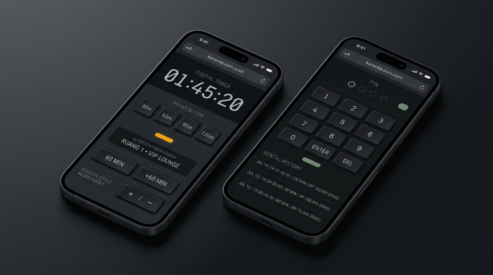
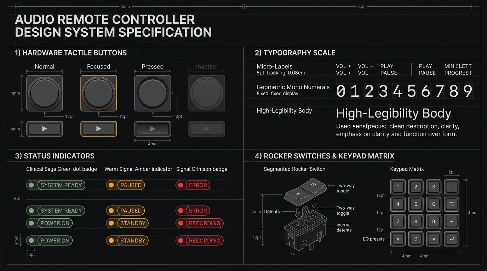
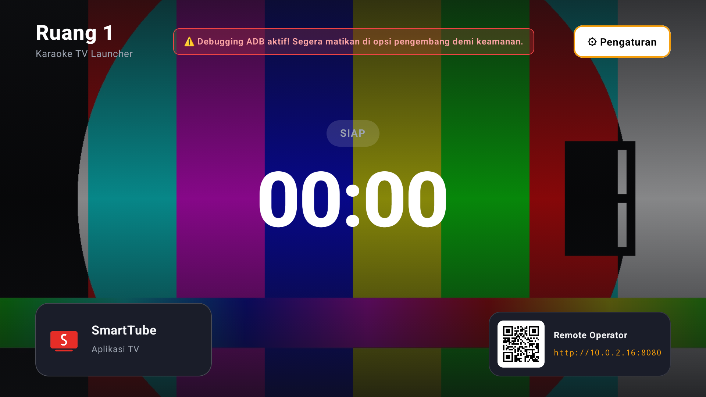
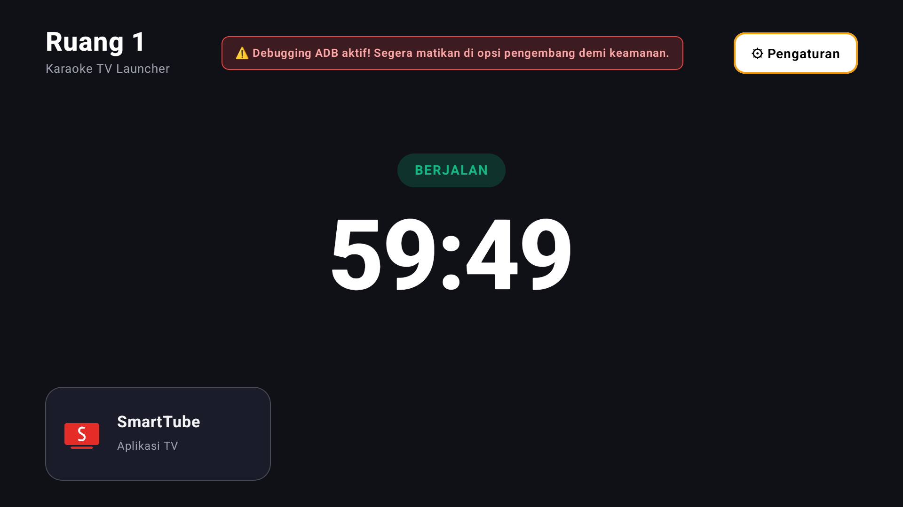
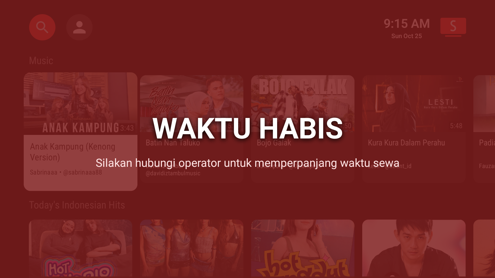
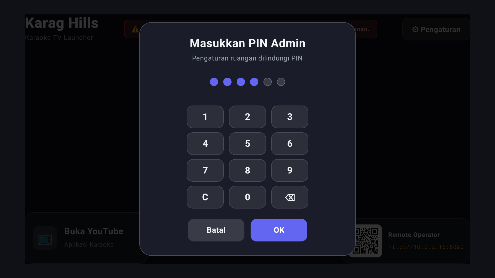
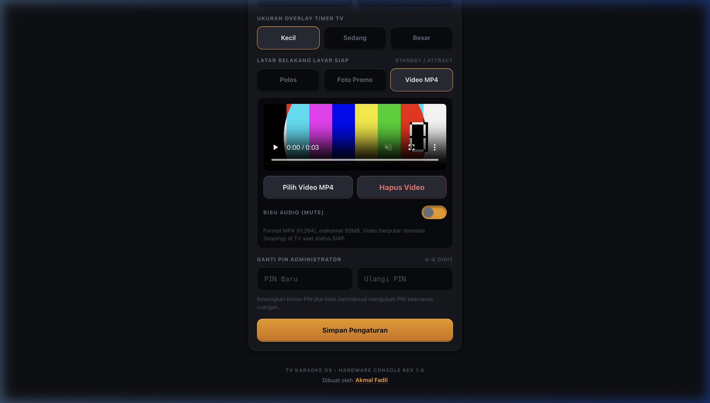
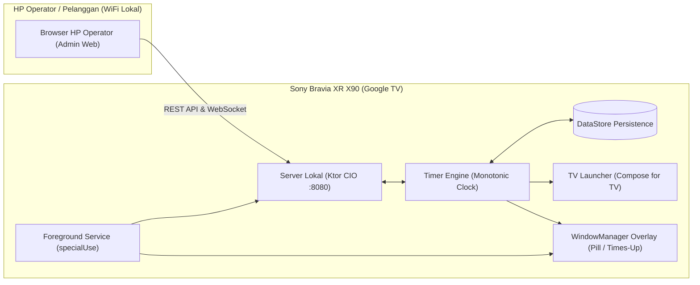

# Launcher Android TV Timer Karaoke

Aplikasi Launcher khusus Android TV / Google TV (**Sony Bravia XR X90 series 55"**) yang menampilkan overlay timer sewa ruang karaoke di atas aplikasi apa pun (seperti YouTube), dan dikendalikan oleh operator melalui antarmuka web di HP dalam satu jaringan WiFi lokal.

---

## 📋 Daftar Isi
- [Galeri Desain & Referensi UI](#-galeri-desain--referensi-ui)
- [Fitur Utama](#-fitur-utama)
- [Arsitektur Teknis](#-arsitektur-teknis)
- [Persyaratan Sistem](#-persyaratan-sistem)
- [Panduan Instalasi ke TV](#-panduan-instalasi-ke-tv)
- [Panduan Penggunaan Operator](#-panduan-penggunaan-operator)
- [Pengembangan & Pengujian](#-pengembangan--pengujian)
- [Perintah Pemulihan (Recovery)](#-perintah-pemulihan-recovery)
- [Pengembang & Konsultasi Profesional (CTA)](#-pengembang--konsultasi-profesional-cta)

---

## 🎨 Galeri Desain & Referensi UI

### 1. Referensi Desain Konseptual (Gemini AI)
Desain antarmuka dirancang dengan gaya *tactile luxury minimalism*, estetika instrumen studio audio, monokromatik gelap, dan micro-label teknis tanpa emoji.

| Mobile Operator Console (Gemini Design) | TV Launcher & Display Specs (Gemini Design) |
| :---: | :---: |
|  |  |

### 2. Implementasi Nyata pada Layar Android TV
Tampilan launcher aktual yang berjalan langsung di TV (Sony Bravia XR X90 Series):

| Mode Siap: Video MP4 Looping Offline | Mode Sesi Aktif: Countdown Bersih | Mode Waktu Habis: Layar Penuh Pelanggan |
| :---: | :---: | :---: |
|  |  |  |

### 3. Implementasi Nyata pada Antarmuka Mobile Admin
Tampilan konsol web remote operator pada browser handphone:

| Menu Pengaturan TV Launcher (Layar TV) | Pengaturan Background Video & Mute (HP) |
| :---: | :---: |
|  |  |

---

## 🚀 Fitur Utama

- **Timer Overlay Monotonik Presisi**: Menampilkan sisa waktu sewa dalam bentuk *pill* di sudut layar di atas aplikasi karaoke apa pun (YouTube / SmartTube). Dihitung menggunakan monotonic clock (`SystemClock.elapsedRealtime()`) sehingga tidak terpengaruh jika jam sistem TV diubah atau disinkronisasi NTP.
- **Layar Penuh "WAKTU HABIS"**: Ketika timer mencapai 00:00, layar TV otomatis dilapisi overlay merah semi-transparan dengan peringatan waktu habis dan tombol navigasi remote ditahan.
- **Latar Layar Siap Dinamis (Video MP4 & Foto Promo Offline)**:
  - Pilihan mode latar: **Polos**, **Foto Promo** (JPEG/PNG/WebP), dan **Video MP4 Looping**.
  - Mengunggah file video MP4 (hingga 50MB) langsung dari HP operator dan disimpan lokal di internal storage TV.
  - Video berputar secara otomatis dan *looping* hanya saat TV berstatus **SIAP (`IDLE`)** dengan lapisan *gradient scrim* gelap agar teks tetap tajam.
  - Dilengkapi sakelar **Bisu Audio (Mute)**.
  - Video otomatis dihentikan dan melepaskan hardware resource (*hardware-accelerated playback release*) saat sesi dimulai, menjamin nol beban CPU/GPU saat pelanggan bernyanyi.
- **Konfigurasi Ruangan & Finansial Dinamis**:
  - Pengaturan **Tarif Sewa per Jam** (*Hourly Rate*) langsung dari tab Pengaturan di HP dengan chip pintasan (35k, 50k, 75k, 100k) serta live preview kalkulasi.
  - Pengubahan **Nama Ruangan** (misal: "Ruang VIP 1", "Room 03") dengan sinkronisasi instan ke header TV dan HP.
  - Penyesuaian **Posisi Overlay Timer TV** (Kanan Atas, Kiri Atas, Kanan Bawah, Kiri Bawah).
  - Penyesuaian **Ukuran Overlay Timer TV** (Kecil, Sedang, Besar).
  - Penggantian **PIN Keamanan Administrator** (4–6 digit).
  - Tombol pintasan **"Buka Pengaturan TV"** di layar launcher TV untuk membuka pengaturan sistem Android TV secara langsung.
- **Manajemen Akses Aplikasi TV (*Allowed Apps Whitelist*)**:
  - Tab "Aplikasi TV" di HP operator membaca seluruh aplikasi yang terpasang di Android TV secara dinamis.
  - Tombol sakelar untuk mengizinkan atau memblokir aplikasi agar hanya aplikasi karaoke (misal SmartTube / YouTube) yang dapat dibuka pelanggan.
- **Rekap Finansial & Audit Riwayat Transaksi**:
  - Filter laporan fleksibel: **Hari Ini** (*Today*), **7 Hari** (*Week*), **Bulan Ini** (*Month*), dan **Semua** (*All*).
  - Ringkasan metrik otomatis: **Total Sesi Sewa**, **Total Jam Pemakaian**, **Rata-rata Durasi**, dan **Total Estimasi Omset Pendapatan (Rp)** yang dihitung otomatis berdasarkan tarif per jam yang aktif.
  - Pencatatan nama pelanggan/tamu pada setiap sesi sewa.
  - Tombol **Hapus Riwayat** dilengkapi modal konfirmasi keamanan.
- **Server Lokal Tersemat (Embedded Ktor CIO)**: TV menjalankan server HTTP dan WebSocket lokal pada port `8080`. Seluruh komunikasi berjalan 100% offline dalam jaringan WiFi lokal tanpa memerlukan sambungan internet.
- **Desain Tactile Minimalism Tanpa Emoji (REV 1.0)**: Antarmuka operator dirancang khusus mengusung estetika *hardware console*, indikator status monokromatik, font monospace teknis, dan kredit resmi *TV KARAOKE OS • HARDWARE CONSOLE REV 1.0 Dibuat oleh Akmal Fadli*.
- **Keamanan & Proteksi Brute-Force**:
  - Halaman admin dan pengaturan TV dilindungi PIN dengan hash PBKDF2-HMAC-SHA256 (100.000 iterasi).
  - Setiap perintah membawa token sesi kriptografis (masa aktif 12 jam).
  - Pembatasan percobaan login (penguncian 5 menit setelah 5 kali salah memasukkan PIN).
  - Peringatan sistem di TV dan HP jika debugging ADB masih dibiarkan aktif.
- **Dukungan Build Otomatis (Release & Debug)**:
  - Skrip `install-tv.sh` mendukung instalasi otomatis versi `release` (teroptimasi dengan sertifikat penandatanganan) maupun versi `debug`.
- **Tahan Restart TV**: Berjalan sebagai Foreground Service tipe `specialUse` dan otomatis pulih saat TV dinyalakan (`BOOT_COMPLETED`).

---

## 🛠 Arsitektur Teknis



- **Bahasa**: Kotlin 2.0.21, JDK 17
- **UI TV**: Jetpack Compose TV (`androidx.tv:tv-material` & `androidx.tv:tv-foundation`)
- **Server**: Ktor 3.0.0 (Engine CIO, WebSockets, Content Negotiation, Kotlinx Serialization)
- **Penyimpanan**: Jetpack DataStore (Preferences)
- **Overlay**: Android `WindowManager` (`TYPE_APPLICATION_OVERLAY`)
- **QR Code**: ZXing Core

---

## 📦 Persyaratan Sistem

- **Perangkat Target**: Sony Bravia XR X90 Series 55" (Google TV, Android 10 – 12).
- **Laptop / Komputer Teknis**: Terpasang `adb` (Android Debug Bridge) dan terhubung ke WiFi yang sama dengan TV.
- **Jaringan**: Router WiFi lokal dengan fitur DHCP IP Reservation (disarankan agar IP TV tidak berubah-ubah).

---

## 📲 Panduan Instalasi ke TV

Pemasangan awal dilakukan secara manual (*sideload*) melalui skrip ADB otomatis yang telah disediakan:

### 1. Persiapan pada TV Sony Bravia
1. Nyalakan TV dan hubungkan ke WiFi lokal.
2. Buka **Settings > System > About**.
3. Gulir ke bawah ke **Android TV OS build**, lalu tekan tombol **OK** pada remote sebanyak **7 kali** hingga muncul pesan *"You are now a developer!"*.
4. Kembali ke **Settings > System > Developer options**, lalu aktifkan **Network debugging** (atau USB debugging).
5. Buka **Settings > System > Power & Energy**:
   - Atur **Idle TV standby** ke **Off** (agar TV tidak otomatis mati sendiri saat sesi karaoke berjalan tanpa input remote).
6. Catat alamat IP TV di **Settings > Network & Internet** (misalnya `192.168.1.105`).

### 2. Jalankan Skrip Instalasi
Dari terminal di laptop/PC Anda, jalankan:

```bash
cd /path/to/tv-launcher-karaoke

# Menginstall versi RELEASE (Default & direkomendasikan untuk operasional)
./scripts/install-tv.sh <IP_TV>
# atau secara eksplisit:
./scripts/install-tv.sh <IP_TV> release

# Menginstall versi DEBUG (Untuk kebutuhan pengembangan/debugging)
./scripts/install-tv.sh <IP_TV> debug
```
*Contoh:*
```bash
./scripts/install-tv.sh 192.168.1.105
```

Skrip ini akan secara otomatis:
- Menghubungkan ADB ke TV (`adb connect <IP>:5555`).
- Mengompilasi dan memasang APK ke TV.
- Memberikan izin overlay (`SYSTEM_ALERT_WINDOW`).
- Mengecualikan aplikasi dari penghemat baterai (*battery optimization whitelist*).
- Menjadikan aplikasi sebagai Home Activity utama (`cmd package set-home-activity`).
- Memastikan launcher bawaan Google TV (`launcherx`) tetap aktif agar tidak memicu watchdog bootloop pada sistem Sony Bravia.
- Membuka aplikasi di TV.

### 3. Selesaikan Setup di Layar TV
1. Gunakan D-pad remote Sony untuk memilih nama ruangan (misal: "Ruang 1").
2. Buat 4 digit PIN Admin.
3. Pindai QR code yang tampil di layar TV dengan HP operator untuk menyimpan halaman kontrol.
4. **PENTING UNTUK KEAMANAN**: Kembali ke menu TV dan **matikan Network Debugging** di Developer Options agar pelanggan karaoke tidak bisa mengakses TV lewat ADB.

---

## 📱 Panduan Penggunaan Operator

1. Hubungkan HP operator ke WiFi yang sama dengan TV.
2. Buka browser dan akses alamat IP TV (misal: `http://192.168.1.105:8080`) atau pindai QR Code yang ada di pojok layar TV.
3. Masukkan PIN Admin yang telah dibuat saat setup.
4. **Navigasi Tab di HP**:
   - **Tab Kontrol Timer**:
     - Masukkan **Nama Pelanggan** (misal: "Budi", "Meja 2").
     - Pilih durasi sewa instan (30m, 60m, 90m, 120m).
     - Nama pelanggan yang sedang aktif akan muncul di atas display timer (dapat diklik langsung untuk mengubah nama jika ada koreksi).
     - Gunakan tombol kontrol bergaya hardware: **Jeda / Lanjut**, **Penyesuaian Waktu (+5m / +10m / -5m)**, atau **Hentikan Sesi** (dengan konfirmasi).
     - Saat waktu habis, kontrol perpanjangan sewa (+30m / +60m) otomatis muncul.
   - **Tab Aplikasi TV**:
     - Menampilkan daftar seluruh aplikasi yang terpasang di Android TV secara dinamis.
     - Aktifkan atau nonaktifkan sakelar (*switch*) untuk mengizinkan aplikasi dibuka pelanggan di launcher.
     - Aplikasi terizinkan otomatis muncul sebagai kartu pintasan di beranda launcher TV.
   - **Tab Rekap & Riwayat**:
     - **Filter Laporan**: Tombol filter instan (Hari Ini, 7 Hari, Bulan Ini, Semua).
     - **Indikator Tarif Acuan**: Menampilkan tarif sewa per jam yang sedang berlaku.
     - **Ringkasan Finansial**: Menampilkan **Total Omset Pendapatan (Rp)**, **Total Sesi**, **Total Jam**, dan **Rata-rata Durasi**.
     - **Daftar Riwayat Rinci**: Nama Pelanggan, Tag Status (`Sedang Aktif`, `Selesai`, `Dihentikan`), Jam Mulai & Jam Selesai, serta rincian durasi perpanjangan.
     - **Tombol Bersihkan Riwayat**: Menghapus arsip riwayat sewa dengan konfirmasi keamanan.
   - **Tab Pengaturan**:
     - **Nama Ruangan**: Mengganti nama ruangan dengan live preview & chip cepat.
     - **Harga Sewa per Jam (Rp)**: Mengatur tarif dasar sewa untuk kalkulasi omset.
     - **Posisi Overlay Timer**: Memilih sudut layar TV (Kanan Atas, Kiri Atas, Kanan Bawah, Kiri Bawah).
     - **Ukuran Overlay**: Mengatur skala ukuran tampilan timer di TV (Kecil, Sedang, Besar).
     - **Latar Belakang Layar Siap**:
       - Pilihan mode: **Polos**, **Foto Promo** (JPEG/PNG/WebP), atau **Video MP4 Looping**.
       - Tombol upload video MP4 (maksimal 50MB) dengan live progress bar & pemutar video preview.
       - Sakelar **Bisu Audio (Mute)**.
     - **Ganti PIN Administrator**: Mengganti 4–6 digit PIN keamanan.

---

## 💻 Pengembangan & Pengujian

### Struktur Folder Project
```
tv-launcher-karaoke/
├── PRD Launcher Android TV Timer Karaoke.md # Dokumen PRD lengkap
├── README.md                                # Dokumentasi petunjuk penggunaan
├── scripts/
│   └── install-tv.sh                        # Skrip instalasi ADB otomatis ke TV
└── app/src/
    ├── main/
    │   ├── AndroidManifest.xml
    │   ├── assets/web/                      # Antarmuka Web Operator (HTML, CSS, JS)
    │   └── java/id/karaoke/timerlauncher/
    │       ├── App.kt                       # Application Container & Singleton
    │       ├── auth/                        # PinHasher, SessionManager, RateLimiter
    │       ├── device/                      # DeviceHealth & Network utilities
    │       ├── overlay/                     # OverlayController (WindowManager)
    │       ├── server/                      # LocalServer (Ktor CIO REST & WebSocket)
    │       ├── service/                     # TimerService (FGS) & BootReceiver
    │       ├── settings/                    # SettingsRepository (DataStore)
    │       ├── timer/                       # TimerEngine, Clock, TimerState
    │       └── ui/                          # Compose TV UI (Home, Setup, Settings)
    └── test/                                # Unit Tests (TimerEngineTest, AuthTest)
```

### Menjalankan Unit Tests
Proyek ini dilengkapi dengan automated unit tests untuk logika bisnis inti (akurasi timer, penanganan reboot, lompatan jam sistem, hashing PIN, session token, dan rate limiter):
```bash
./gradlew testDebugUnitTest
```

### Menjalankan di Emulator Android TV
Jika Anda tidak sedang berada di dekat TV fisik, Anda dapat menguji seluruh fungsi launcher dan web remote langsung di **Emulator Android TV**:
```bash
./scripts/run-emulator.sh
```
Skrip ini akan secara otomatis:
1. Mendeteksi AVD Android TV (misal: `Television_1080p`).
2. Mengompilasi dan memasang APK ke emulator.
3. Mengaktifkan izin `SYSTEM_ALERT_WINDOW` (overlay) dan whitelist penghemat baterai.
4. Meneruskan port server TV (`adb forward tcp:8080 tcp:8080`).
5. Membuka aplikasi di emulator TV.

Setelah aplikasi berjalan di emulator:
- **Navigasi TV**: Gunakan tombol panah keyboard (D-Pad), `Enter` (Pilih), dan `Esc/Backspace` (Kembali).
- **Web Remote Operator**: Buka browser di laptop Anda di `http://localhost:8080` atau dari HP Anda di `http://<IP_LAPTOP>:8080`.

### Mengompilasi APK Debug
```bash
./gradlew assembleDebug
```
File APK hasil kompilasi berlokasi di:
`app/build/outputs/apk/debug/app-debug.apk`

---

## 🔄 Perintah Pemulihan (Recovery)

Jika terjadi kendala bootloop atau TV ingin dipulihkan / dikembalikan ke launcher Google TV bawaan, jalankan skrip pemulihan otomatis:

```bash
# Pemulihan otomatis (via WiFi atau USB)
./scripts/rescue-tv.sh <IP_TV>

# Atau jika TV terhubung kabel USB ke laptop:
./scripts/rescue-tv.sh
```

Atau secara manual lewat ADB:

```bash
# Mengaktifkan kembali launcher Google TV bawaan
adb connect <IP_TV>:5555
adb shell cmd package enable com.google.android.apps.tv.launcherx
adb shell pm enable com.google.android.apps.tv.launcherx

# (Opsional) Menghapus aplikasi karaoke launcher
adb shell pm uninstall id.karaoke.timerlauncher
```

---

## 👨‍💻 Pengembang & Konsultasi Profesional (CTA)

Projek **Launcher Android TV Timer Karaoke** ini dirancang dan dibangun secara profesional oleh:

### **Akmal Fadli**
*Full-Stack Engineer, Android & Embedded Solutions Specialist*

- 🌐 **Portfolio & Kontak**: [akmalfadli.github.io](https://akmalfadli.github.io)
- 🐙 **GitHub**: [github.com/akmalfadli](https://github.com/akmalfadli)

---

### 🚀 Butuh Solusi Custom TV Launcher atau Sistem Serupa?

Apakah Anda mengelola bisnis karaoke, rental PlayStation, hotel, gym, atau ruang publik komersial yang membutuhkan integrasi sistem Android TV kustom?

Kami menerima layanan perancangan dan pengerjaan proyek profesional:
- 📺 **Custom Android TV / Google TV Launcher & Kiosk Systems**: Tampilan custom brand, penguncian sistem dari tangan pelanggan, dan navigasi ramah remote TV.
- ⏱️ **Billing & Timer Overlays**: Sistem penghitung sewa akurat dengan overlay floating yang berjalan di atas aplikasi pihak ketiga (seperti YouTube, Spotify, atau pemutar karaoke).
- 📱 **Mobile Web Console & Local Control**: Kontrol nirkabel berbasis browser tanpa perlu internet (100% offline di jaringan lokal), responsif dan mudah digunakan staf operasional.
- 🔒 **Device Hardening & ADB Security**: Proteksi tamper-proof, pencegahan bypass pengguna, dan audit transaksi rental.
- 📊 **Financial Reporting & Automation**: Rekap pendapatan otomatis, kalkulasi tarif sewa, dan integrasi sistem kasir/POS.

Tertarik membangun sistem kustom untuk bisnis Anda?  
Kunjungi portofolio dan hubungi langsung melalui:  
👉 **[akmalfadli.github.io](https://akmalfadli.github.io)**
