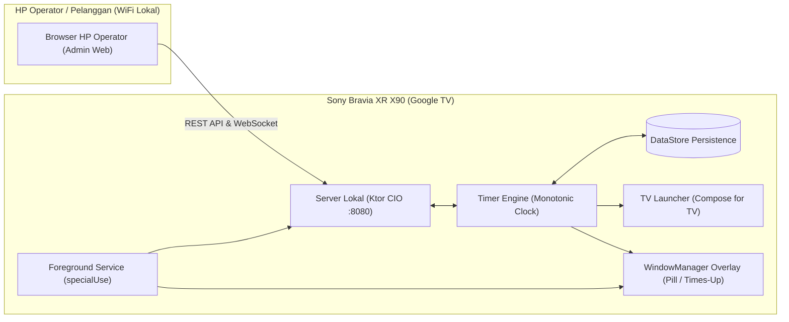

# Launcher Android TV Timer Karaoke

Aplikasi Launcher khusus Android TV / Google TV (**Sony Bravia XR X90 series 55"**) yang menampilkan overlay timer sewa ruang karaoke di atas aplikasi apa pun (seperti YouTube), dan dikendalikan oleh operator melalui antarmuka web di HP dalam satu jaringan WiFi lokal.

---

## 📋 Daftar Isi
- [Fitur Utama](#-fitur-utama)
- [Arsitektur Teknis](#-arsitektur-teknis)
- [Persyaratan Sistem](#-persyaratan-sistem)
- [Panduan Instalasi ke TV](#-panduan-instalasi-ke-tv)
- [Panduan Penggunaan Operator](#-panduan-penggunaan-operator)
- [Pengembangan & Pengujian](#-pengembangan--pengujian)
- [Perintah Pemulihan (Recovery)](#-perintah-pemulihan-recovery)

---

## 🚀 Fitur Utama

- **Timer Overlay Akurat**: Menampilkan sisa waktu sewa dalam bentuk *pill* di sudut layar di atas aplikasi karaoke (YouTube). Dihitung menggunakan monotonic clock (`SystemClock.elapsedRealtime()`) sehingga tidak terpengaruh jika jam sistem TV diubah atau disinkronisasi NTP.
- **Layar Penuh "WAKTU HABIS"**: Ketika timer mencapai 00:00, layar TV otomatis dilapisi overlay merah semi-transparan dengan peringatan waktu habis.
- **Server Lokal Tersemat (Embedded Ktor)**: TV menjalankan server HTTP dan WebSocket lokal pada port `8080`. Seluruh komunikasi berjalan offline dalam jaringan lokal (tidak memerlukan koneksi internet).
- **Remote Web Operator (Mobile-First)**: Operator dapat mengontrol timer dari browser HP (mulai 30/60/90/120 menit, jeda, lanjutkan, tambah/kurang waktu, dan perpanjang sewa).
- **Setup Wizard Interaktif**: Konfigurasi nama ruangan (misal: "Ruang 1"), pembuatan PIN admin, pengecekan izin sistem, serta tampilan QR code langsung pada layar TV saat pertama kali dinyalakan.
- **Keamanan & Proteksi Brute-Force**:
  - Halaman admin dan pengaturan TV dilindungi PIN dengan hash PBKDF2-HMAC-SHA256 (100.000 iterasi).
  - Setiap perintah membawa token sesi kriptografis (masa aktif 12 jam).
  - Pembatasan percobaan login (penguncian 5 menit setelah 5 kali salah memasukkan PIN).
  - Peringatan sistem di TV dan HP jika debugging ADB masih dibiarkan aktif.
- **Tahan Restart TV**: Berjalan sebagai Foreground Service tipe `specialUse` dan otomatis pulih saat TV dinyalakan (`BOOT_COMPLETED`).

---

## 🛠 Arsitektur Teknis



- **Bahasa**: Kotlin 2.0.21, JDK 17
- **UI TV**: Jetpack Compose TV (`androidx.tv:tv-material` & `androidx.tv:tv-foundation`)
- **Server**: Ktor 3.0.0 (Engine CIO, WebSockets, Content Negotiation, Kotlinx Serialization)
- **Penyimpanan**: Jetpack DataStore (Preferences)
- **Overlay**: Android `WindowManager` (`TYPE_APPLICATION_OVERLAY`)
- **QR Code**: ZXing Core

---

## 📦 Persyaratan Sistem

- **Perangkat Target**: Sony Bravia XR X90 Series 55" (Google TV, Android 10 – 12).
- **Laptop / Komputer Teknis**: Terpasang `adb` (Android Debug Bridge) dan terhubung ke WiFi yang sama dengan TV.
- **Jaringan**: Router WiFi lokal dengan fitur DHCP IP Reservation (disarankan agar IP TV tidak berubah-ubah).

---

## 📲 Panduan Instalasi ke TV

Pemasangan awal dilakukan secara manual (*sideload*) melalui skrip ADB otomatis yang telah disediakan:

### 1. Persiapan pada TV Sony Bravia
1. Nyalakan TV dan hubungkan ke WiFi lokal.
2. Buka **Settings > System > About**.
3. Gulir ke bawah ke **Android TV OS build**, lalu tekan tombol **OK** pada remote sebanyak **7 kali** hingga muncul pesan *"You are now a developer!"*.
4. Kembali ke **Settings > System > Developer options**, lalu aktifkan **Network debugging** (atau USB debugging).
5. Buka **Settings > System > Power & Energy**:
   - Atur **Idle TV standby** ke **Off** (agar TV tidak otomatis mati sendiri saat sesi karaoke berjalan tanpa input remote).
6. Catat alamat IP TV di **Settings > Network & Internet** (misalnya `192.168.1.105`).

### 2. Jalankan Skrip Instalasi
Dari terminal di laptop/PC Anda, jalankan:

```bash
cd /path/to/tv-launcher-karaoke
./scripts/install-tv.sh <IP_TV>
```
*Contoh:*
```bash
./scripts/install-tv.sh 192.168.1.105
```

Skrip ini akan secara otomatis:
- Menghubungkan ADB ke TV (`adb connect <IP>:5555`).
- Mengompilasi dan memasang APK ke TV.
- Memberikan izin overlay (`SYSTEM_ALERT_WINDOW`).
- Mengecualikan aplikasi dari penghemat baterai (*battery optimization whitelist*).
- Menjadikan aplikasi sebagai Home Activity utama.
- Menonaktifkan launcher bawaan Google TV (`launcherx`) agar tombol **Home** pada remote membuka launcher karaoke.
- Membuka aplikasi di TV.

### 3. Selesaikan Setup di Layar TV
1. Gunakan D-pad remote Sony untuk memilih nama ruangan (misal: "Ruang 1").
2. Buat 4 digit PIN Admin.
3. Pindai QR code yang tampil di layar TV dengan HP operator untuk menyimpan halaman kontrol.
4. **PENTING UNTUK KEAMANAN**: Kembali ke menu TV dan **matikan Network Debugging** di Developer Options agar pelanggan karaoke tidak bisa mengakses TV lewat ADB.

---

## 📱 Panduan Penggunaan Operator

1. Hubungkan HP operator ke WiFi yang sama dengan TV.
2. Buka browser dan akses alamat IP TV (misal: `http://192.168.1.105:8080`) atau pindai QR Code yang ada di pojok layar TV.
3. Masukkan PIN Admin yang telah dibuat saat setup.
4. **Kontrol yang Tersedia**:
   - **Mulai Sesi**: Pilih preset cepat (30m, 60m, 90m, 120m).
   - **Jeda / Lanjut**: Menjeda atau melanjutkan hitungan timer.
   - **Tambah / Kurang Waktu**: Tombol +5m, +10m, atau -5m.
   - **Perpanjang Waktu**: Saat waktu habis, tombol perpanjang +30m dan +60m akan muncul secara otomatis.
   - **Hentikan**: Mengakhiri sesi sewa ruangan.

---

## 💻 Pengembangan & Pengujian

### Struktur Folder Project
```
tv-launcher-karaoke/
├── PRD Launcher Android TV Timer Karaoke.md # Dokumen PRD lengkap
├── README.md                                # Dokumentasi petunjuk penggunaan
├── scripts/
│   └── install-tv.sh                        # Skrip instalasi ADB otomatis ke TV
└── app/src/
    ├── main/
    │   ├── AndroidManifest.xml
    │   ├── assets/web/                      # Antarmuka Web Operator (HTML, CSS, JS)
    │   └── java/id/karaoke/timerlauncher/
    │       ├── App.kt                       # Application Container & Singleton
    │       ├── auth/                        # PinHasher, SessionManager, RateLimiter
    │       ├── device/                      # DeviceHealth & Network utilities
    │       ├── overlay/                     # OverlayController (WindowManager)
    │       ├── server/                      # LocalServer (Ktor CIO REST & WebSocket)
    │       ├── service/                     # TimerService (FGS) & BootReceiver
    │       ├── settings/                    # SettingsRepository (DataStore)
    │       ├── timer/                       # TimerEngine, Clock, TimerState
    │       └── ui/                          # Compose TV UI (Home, Setup, Settings)
    └── test/                                # Unit Tests (TimerEngineTest, AuthTest)
```

### Menjalankan Unit Tests
Proyek ini dilengkapi dengan automated unit tests untuk logika bisnis inti (akurasi timer, penanganan reboot, lompatan jam sistem, hashing PIN, session token, dan rate limiter):
```bash
./gradlew testDebugUnitTest
```

### Mengompilasi APK Debug
```bash
./gradlew assembleDebug
```
File APK hasil kompilasi berlokasi di:
`app/build/outputs/apk/debug/app-debug.apk`

---

## 🔄 Perintah Pemulihan (Recovery)

Jika suatu saat TV ingin dikembalikan ke launcher standar Google TV bawaan pabrik, sambungkan TV ke laptop lewat ADB dan jalankan:

```bash
# Mengaktifkan kembali launcher Google TV bawaan
adb connect <IP_TV>:5555
adb shell pm enable com.google.android.apps.tv.launcherx

# (Opsional) Menghapus aplikasi karaoke launcher
adb shell pm uninstall id.karaoke.timerlauncher
```
